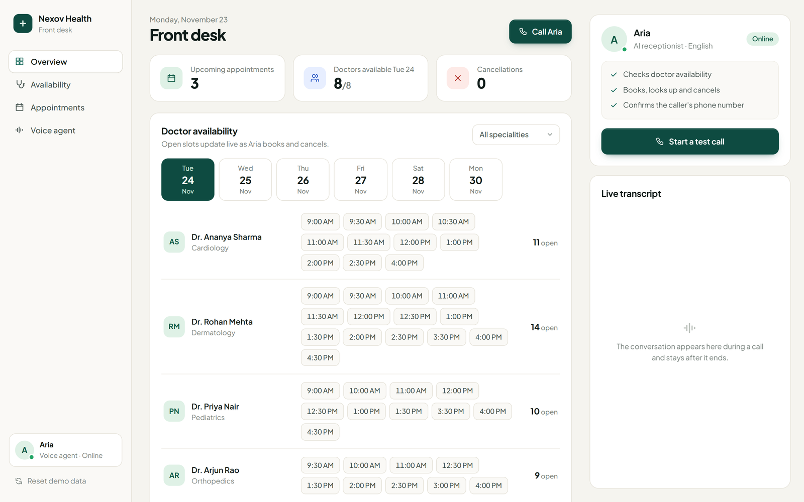
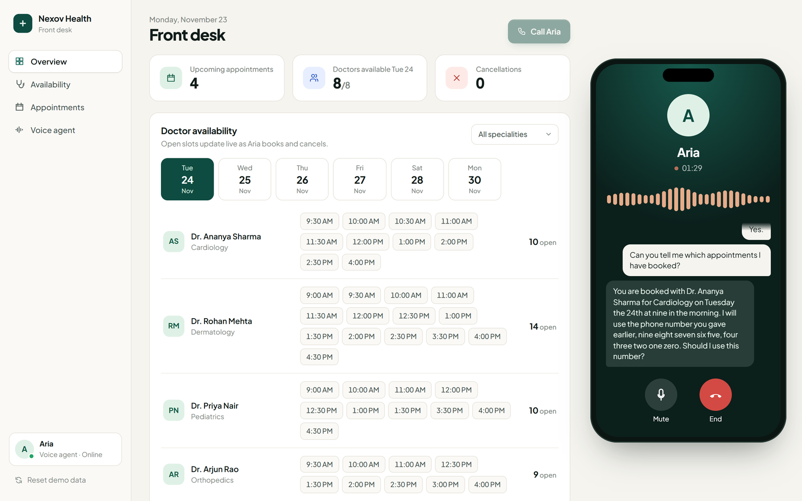
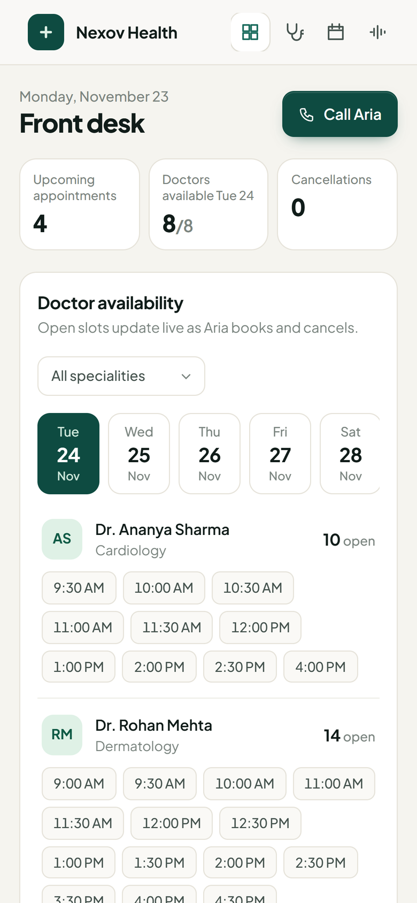

# Nexov Health · Voice Doctor Appointment Assistant

A caller talks to **Aria**, an AI receptionist, to check a doctor's availability, book an appointment, look up their existing appointments and cancel one, all in a single conversation. The caller is identified **only by the phone number they say out loud**: no login, no OTP, no caller ID. A web dashboard runs the call and shows doctors, slots, appointments and the live transcript.

| | |
|---|---|
| Voice pipeline | **Pipecat** (Python) |
| Speech to text | **ElevenLabs** Scribe realtime |
| Text to speech | **ElevenLabs** Flash v2.5 (voice "Jessica") |
| LLM | **Groq `openai/gpt-oss-120b`** (free tier, low latency) with function calling. **Google Gemini** `gemini-3.5-flash-lite` → `3.6-flash` → `3.7-flash` are automatic fallbacks. Gemini alone also works. |
| Turn detection | Silero VAD |
| Frontend | Vite + React + TypeScript, hand-written CSS |
| Data | SQLite mock data (8 doctors, 30 minute slots for the coming week) |

## Screenshots

**Front desk dashboard.** Live doctor availability, appointments and the voice agent panel.



**During a call.** The phone docks beside the dashboard. Here Aria has just booked a cardiology slot (9:00 AM is gone from Dr. Sharma's row) and offers to reuse the number the caller confirmed earlier.



<p align="center"><b>Mobile</b><br></p>

## Run it

You need Python 3.10+, Node 18+, an [ElevenLabs API key](https://elevenlabs.io/app/settings/api-keys) (Text to Speech and Speech to Text permissions), and a [Groq API key](https://console.groq.com/keys) and/or a [Gemini API key](https://aistudio.google.com/apikey). Groq replies fastest; with both, Gemini takes over if Groq is rate-limited.

```bash
# 1. backend
cd backend
python -m venv .venv
.venv\Scripts\activate            # macOS/Linux: source .venv/bin/activate
pip install -r requirements.txt
copy .env.example .env            # macOS/Linux: cp .env.example .env   then paste your two keys
python server.py                  # http://localhost:7860

# 2. frontend (second terminal)
cd frontend
npm install
npm run dev                       # http://localhost:5173 (proxies /api to :7860)
```

Open http://localhost:5173, press **Try call**, allow the microphone and talk. Headphones give the best results, because Aria's voice won't leak back into the mic.

To serve everything from one port, run `npm run build` once in `frontend/` and open http://localhost:7860. The backend serves the built dashboard.

**Demo script:** *"I'd like to see a skin doctor tomorrow."* → pick a time → give your name and number → Aria reads the number back → *"Yes"* → booked, and the dashboard updates. In the same call: *"Actually, cancel that appointment."* → number confirmed again → cancelled. **Reset** in the header restores the sample data.

## How it works

```
browser mic ─WebRTC─▶ ElevenLabs STT ─▶ Silero VAD / turn end ─▶ Gemini ─▶ ElevenLabs TTS ─WebRTC─▶ speaker
                                                                   │  ▲
                                                       tool call   ▼  │ result
                                     check_doctor_availability · book_appointment · cancel_appointment
                                                                   │
                                                  SQLite ──▶ SSE /api/events ──▶ dashboard refresh + highlight
```

| File | What it does |
|---|---|
| `backend/bot.py` | The Pipecat pipeline, system prompt, turn-taking and model settings. |
| `backend/tools.py` | The three tools and their JSON schemas, registered on the LLM service. |
| `backend/db.py` | SQLite data layer, phone-number parsing and the booking rules. |
| `backend/server.py` | FastAPI app: WebRTC signalling, REST, SSE and health check. It serves the built dashboard. |
| `backend/config.py` | All settings, read from `backend/.env`. |
| `frontend/src/useCall.ts` | Browser call client (Pipecat RTVI over WebRTC): transcript, mute, sounds, waveform. |
| `frontend/src/useLive.ts` | Dashboard data, refreshed instantly by server-sent events. |

### Phone-number rule (enforced in code, not only in the prompt)
- `book_appointment` and `cancel_appointment` refuse to run unless `phone_confirmed=true`. The prompt only lets Aria set that after reading the number back in words and hearing a yes.
- Numbers are parsed from digits or words ("nine eight double seven…", "+91 …") and must come out to 10 digits.
- A cancellation only touches appointments booked under that number.

### Reliability
- **Slot booking is atomic.** Two callers can't get the same slot, and past slots are refused.
- **Tools always answer.** An unexpected error returns a polite failure to the LLM instead of leaving the caller in silence.
- **Model failover.** On a rate limit (429), an outage (5xx) or a stall, the call switches to the next model in the chain and retries that turn. The caller just hears the answer.
- **Long calls stay fast.** Older turns are summarised once the history passes ~4k tokens, and tool results are kept compact.
- **No dead air.** A short holding line ("One moment, let me check.") plays while a tool runs.
- **Concurrent calls are capped.** The limit is `MAX_CONCURRENT_CALLS`, and extra callers hear "all lines busy".
- **Ended calls free their server resources.** A call that is hung up, closed or silent for `CALL_IDLE_TIMEOUT_SECS` is shut down.
- **`/api/health` reports configuration.** It shows whether the keys are set and how many calls are active. The dashboard uses it to show the agent's status and give a precise error before a call.

## Configuration (`backend/.env`)

| Variable | Default | |
|---|---|---|
| `ELEVENLABS_API_KEY` | (required) | |
| `GROQ_API_KEY` | (recommended) | Primary LLM when set. |
| `GROQ_MODEL` | `openai/gpt-oss-120b` | |
| `GOOGLE_API_KEY` | (required if no Groq key) | Gemini, the fallback models. |
| `GEMINI_FALLBACK_MODELS` | `gemini-3.6-flash,gemini-3.7-flash` | Tried in order when the previous model fails. |
| `GEMINI_MODEL` | `gemini-3.5-flash-lite` | Run `python scripts/list_models.py` to see which models your key can use. |
| `ELEVENLABS_VOICE_ID` | `cgSgspJ2msm6clMCkdW9` (Jessica) | Free plans can't use library voices. Run `python scripts/check_voices.py` to test. |
| `MAX_CONCURRENT_CALLS` | `3` | |
| `CALL_IDLE_TIMEOUT_SECS` | `120` | |
| `ALLOWED_ORIGINS` | `http://localhost:5173` | Comma-separated CORS origins. |
| `PORT` / `HOST` | `7860` / `0.0.0.0` | |
| `LOG_LEVEL` | `INFO` | Use `DEBUG` for Pipecat's detailed logs. |
| `CLINIC_TIMEZONE` | `Asia/Kolkata` | One clock for Aria's calendar, slot generation and the dashboard, so they agree on "today" wherever the server runs. |

## Tests

```bash
cd backend
pip install -r requirements-dev.txt
python -m pytest -q
```

39 tests cover phone parsing, every date format callers use ("Wednesday the 25th", "Nov 25", "25/11", a wrong year from the LLM), availability by speciality, symptom, doctor and date, slots disappearing on booking and returning on cancel, the confirmation rule, double booking, appointment lookup, cancelling one of several appointments, ownership checks and tool error handling. They need no API keys or network.

## Troubleshooting

| Symptom in the backend log | Fix |
|---|---|
| `paid_plan_required` / "completed with no audio" | The voice isn't available on your ElevenLabs plan. Set another `ELEVENLABS_VOICE_ID` (see `scripts/check_voices.py`). |
| `404 … model … no longer available` | Set `GEMINI_MODEL` to one listed by `scripts/list_models.py`. |
| `429 RESOURCE_EXHAUSTED` | You hit the Gemini free-tier requests-per-minute limit. Wait a minute, or use a model with a larger quota. |
| Phone keeps ringing, then "did not answer" | Check the log for one of the errors above. |

## Bonus features

Silero VAD, a phone-style call screen (ringing → connected → ended, caller name, timer, mute, end, transcript inside), a live waveform that reacts to both voices, a booking or cancel confirmation card inside the phone, dashboard rows that highlight when the agent books or cancels, synthesised ring and end-call tones, and a mobile layout.

## Notes

- Sample data only. Slots are regenerated for the coming week on startup, and Sundays are closed.
- No API keys are committed. `backend/.env` is ignored by git, and `backend/.env.example` lists every setting.
